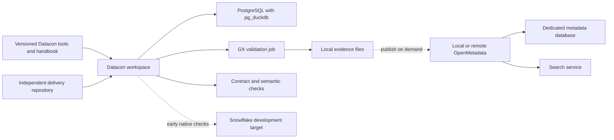

# Datacon implementation plan

Updated: 2026-10-29. Status: design and backlog; runtime implementation and compatibility testing have not started. This revision incorporates the confirmed requirements and the review of [Opharma PR #1](https://github.com/mcgrath-bpt/opharma/pull/1).

Datacon is a versioned development environment and engineering handbook. Developers obtain the platform repository, learn the working conventions, and use its container to deliver pipelines in independent Git repositories. Local development is the default; native Snowflake validation arrives in the first two implementation iterations, before the full catalogue integration.

Read [BACKLOG.md](BACKLOG.md) for prioritised, testable work, [the working guide](docs/WORKING_GUIDE.md) for the proposed team workflow, and [the Opharma reference](docs/OPHARMA_REFERENCE.md) for inspected use cases and evidence boundaries.

The [platform and delivery operating model](docs/OPERATING_MODEL.md) clarifies the boundary: the Tech Lead governs the shared baseline and delivery dependencies; developers can retain personal workspaces or start fresh. Separate Git repositories do not require separate containers or independent development toolchains.

## 1. Confirmed direction

- Version infrastructure, dependencies, configuration templates, contracts, semantics, examples, tests, decisions, onboarding and the backlog.
- Keep each delivery repository independently owned, versioned and releasable. Record the approved Datacon release used for acceptance; shared dependency changes require Tech Lead agreement and platform-controlled provision.
- Optimise the default experience for modest laptops. Include OpenMetadata in v1 while allowing its service group to be stopped for lightweight daily work.
- Support Apple Silicon and Windows with WSL package version 3.0.3, a Linux distribution running under WSL 2, and a compatible container runtime. Linux AMD64 is also a CI target.
- Prefer Great Expectations Core (GX Core) for quality validation. Soda is an alternative only if an actual compatibility need appears.
- Treat semantics as an input to pipeline construction from the beginning. Agent-assisted pipeline delivery is an explicit later milestone, with the supporting contracts and tests built early.
- Use Opharma as the first substantial delivery repository. Preserve its existing behaviour and evidence while qualifying additional runtimes.

Use [Devcon](https://github.com/nicolaka/devcon) as inspiration for a disposable tool workspace. Build a focused data-development image and manage stateful services independently.

## 2. Platform and delivery repositories

The Tech Lead owns the platform baseline: image, bootstrap commands, supported component matrix, approved dependency/capability definitions, reusable adapters, team conventions and platform tests. A delivery repository owns business requirements, contracts, transformations, semantic definitions, fixtures, domain tests and deployment configuration. Projects may depend on each other through explicit, versioned interfaces without becoming part of Datacon.

Illustrative persistent workspace layout, visible inside the container through a host bind mount or named volume:

```text
/workspaces/
  opharma/                 # Independent Git repository
  another-pipeline/        # Independent Git repository
```

Start the approved Datacon environment, then clone or open delivery repositories inside its persistent workspace. Host-side checkouts can also be mounted. Make released platform tools and guidance available separately, such as `/opt/datacon`. One workspace may hold several projects; isolated instances remain available for individual tasks. Container recreation must preserve retained uncommitted work.

A minimal compatibility declaration, such as `.datacon/project.yaml`, can record the approved baseline release/image and selected platform capabilities. Working-directory, target and command metadata can be added when needed; this must not define a competing toolchain or import Datacon source. For Opharma, the working subdirectory is `pharma-commercial-lab/`; adoption must not require moving its existing files.

Keep machine-specific paths in an ignored local registry. Do not copy a delivery repository into the platform repository or require submodules. An optional delivery Dev Container descriptor may reference the approved image for convenience; it must not become a separately maintained baseline.

Use project-specific Compose names, networks, volumes, database identities and output directories. Starting, resetting or stopping project A must not affect B. Keep only the selected project's services running by default. Repository separation provides independent histories; runtime isolation requires its own tests.

Release the image and tooling together with compatibility notes and a supported-release policy. Personal experimental installs are permitted. Once a tool/package/version becomes a delivery prerequisite, the developer must agree it with the Tech Lead and its reproducible provision must be resolved in the platform repository before handoff. Project manifests/lockfiles record approved application requirements; they do not authorise independent toolchain changes. Platform-owned optional features or isolated environments keep the base modest even when one project needs an extra capability.

Provide explicit resume and fresh workflows. Resume retains chosen personal state. Fresh creates a new baseline and isolated task workspace without deleting retained repositories. Clean acceptance excludes personal overlays, inherited virtual environments/node_modules and uncontrolled database state. Required CI checks and review rules enforce the approved handoff path.

## 3. Lean runtime and portability



| Mode | What runs | Resource policy |
| --- | --- | --- |
| Workspace | Shell, Git, Python, project tools and static checks; Opharma's existing SQLite baseline can run here | No database or catalogue service required for the initial reference replay |
| Core, default for database development | Workspace and PostgreSQL/pg_duckdb; GX and generation run as jobs | Design envelope: 2 vCPUs and 4 GiB total container/VM allocation; measure idle and peak use |
| Snowflake | Workspace plus the cloud connector and target tests | No local Snowflake service; warehouse selection and limits are explicit |
| Full v1 platform | Core plus OpenMetadata, dedicated PostgreSQL metadata database and Elasticsearch; ingestion runs as a job | Required v1 capability; measure full resource use separately; the catalogue group can be stopped for core work |
| Extended, later | An orchestrator, object-store emulator, notebooks or local model runtime when needed | Separate capability profiles; never default prerequisites |

The 4 GiB figure is a target, not a benchmark result or a complete host-memory requirement. M1 must demonstrate the reference workload under that cap with bounded connections and conservative per-session DuckDB memory/thread limits. Measure container memory, VM allocation, elapsed time and disk use; do not hide mandatory services outside the budget. Concurrent project performance is a separate test.

OpenMetadata is a required, platform-owned v1 component. The [v1 service inventory](docs/V1_SERVICES.md) specifies five long-running containers: workspace, warehouse, OpenMetadata server, metadata PostgreSQL and Elasticsearch. Bootstrap and metadata ingestion are short-lived jobs; GX, ODCS and semantic checks run through workspace/CI tools. Everyday editing and local checks must work with the catalogue group stopped. Use a supported, tested release combination for server, database, search and ingestion SDK. Command-driven ingestion avoids a permanently running scheduler; UI-managed ingestion requires the additional Airflow integration and can be added separately. See [OpenMetadata deployment](https://docs.open-metadata.org/v2.0.x/deployment/docker).

WSL 3.0.3 is an actual package release. Test that package explicitly, record `wsl --version`, the distribution mode, Docker/Compose versions and Windows build, and distinguish it from the WSL 2 execution architecture. Store checkouts in the Linux filesystem, use LF line endings, preserve executable bits, and test paths with spaces, file ownership, bind mounts, ports and editor reopening. Native Linux CI alone does not certify WSL. See [WSL 3.0.3](https://github.com/microsoft/WSL/releases/tag/3.0.3) and [Microsoft's Dev Container guidance](https://learn.microsoft.com/en-us/windows/dev-environment/docker/dev-containers).

## 4. Contracts and quality

Use ODCS 3.1 for the first integrated Opharma example. Recognise and validate both JSON and YAML and the declared ODCS version. Opharma's existing JSON contracts and vendored schema remain valid inputs; no format rewrite is required.

Git is authoritative for contracts and their managed catalogue fields. Generate supported initial DDL, GX Expectation Suites and documentation deterministically, recording source checksums and generator versions. Schema evolution produces an explicit migration proposal and compatibility report. A contract change must not silently drop a column or alter an existing dataset's meaning.

### Quality engine decision

GX Core is the preferred starting engine because this is a Python-based workflow with PostgreSQL locally and Snowflake as the target. GX documents both backends and batch-aware validation. Data Contract CLI already exports GX 1.x suites, reducing the amount of custom generation required. This is a fit assessment; the exact pinned versions still need execution tests. See [GX SQL sources](https://docs.greatexpectations.io/docs/core/connect_to_data/sql_data/), [Checkpoints](https://docs.greatexpectations.io/docs/core/trigger_actions_based_on_results/run_a_checkpoint/), and the [GX exporter](https://cli.datacontract.com/exports/great-expectations).

| Choice | Fit here | Consequence |
| --- | --- | --- |
| GX Core | Preferred Python library; suites and structured results; local and Snowflake execution | Configure Data Context, assets, batches, suites and Checkpoints; qualify exporter and dependency compatibility |
| Soda Core | Remains a viable alternative | No default installation or second set of rules; revisit for a concrete requirement |
| Opharma's domain validators and independent evaluator | Necessary for temporal/business correctness | Preserve them; GX checks complement their assertions rather than replace them |

The adapter must declare which ODCS constraints it executes. Cover required values, types, keys, accepted values, ranges and supported relationships. Use explicit custom SQL/Python checks for unsupported cross-table or temporal rules. Fail unsupported executable rules during generation and expose descriptive-only fields as metadata.

Preserve `PASS`, `ALERT`, `FAIL`, `ERROR` and `NO_DATA` in the common result model, with explicit publication policy. An expected business alert can coexist with correct pipeline output. Structural errors block publication; a failed validator is an execution error; an empty population must not become a vacuous success. Preserve metric, threshold, severity, stable rule ID, snapshot, contract hash, engine version and code revision. Test exact threshold boundaries.

Opharma already distinguishes these outcomes. Do not reinterpret its recorded 756 passing assertions as evidence that the sources contain no quality issues. Reproduce the baseline and review any intentional rule change in the delivery repository.

### Database behaviour

Keep PostgreSQL tables as the local authoritative storage. Candidate pg_duckdb versions must pass role/RLS tests with acceleration enabled and disabled, including joins, views and prepared statements under non-owner roles. Inspect plans to prove the accelerated path was exercised. Separate file access from table access and bound concurrent queries.

pg_duckdb 1.1 introduced support for reading RLS-protected PostgreSQL tables. Open reports on 1.1.1 describe complex-scan crashes and hangs, so include bounded concurrency/cancellation checks and retain plain PostgreSQL execution for affected workloads. See [release notes](https://github.com/duckdb/pg_duckdb/releases/tag/v1.1.0), [reported crash](https://github.com/duckdb/pg_duckdb/issues/1084), and [reported hang](https://github.com/duckdb/pg_duckdb/issues/1085). Select and pin versions through tests rather than assuming the earlier candidate combination is qualified.

ODCS ownership declarations do not implement database permissions. Keep PostgreSQL RLS and Snowflake row access policies explicit, separately mapped and independently tested.

## 5. Semantics and agent-built pipelines

The semantic layer must describe enough meaning for a person or agent to construct the right pipeline: entity grain, keys, authoritative sources, allowed joins/cardinality, measures and aggregation rules, units, NULL/zero behaviour, effective time versus arrival time, correction/deletion rules, publication cadence and access intent.

Create a small versioned semantic bundle that links these definitions to ODCS IDs and native target artefacts. Reuse existing contracts and metadata before inventing another modelling language. Keep executable expressions in their native dialects and declare supported mappings.

Opharma already has a Power BI TMDL model. Preserve it as a first-class target alongside new Snowflake Semantic View YAML. SQL and DAX are not interchangeable, and equivalent file shapes do not prove equivalent results. Use shared business examples and expected outputs to test both. Native TMDL/DAX/refresh validation needs an appropriate Microsoft engine; it is not established by parsing text in a Linux container.

The first Snowflake semantic example belongs in M2. Snowflake recommends Semantic Views for new definitions; local tests can validate references and selected calculations while native creation and queries prove target support. See [Semantic View YAML](https://docs.snowflake.com/en/user-guide/views-semantic/semantic-view-yaml-spec).

Build towards this agent workflow:

1. Read a scoped business request, approved contracts, semantic bundle and project conventions.
2. Propose a pipeline plan with source-to-target mappings and unresolved assumptions.
3. Generate code, migrations and tests inside the delivery repository.
4. Execute bounded local fixtures and contract, quality, access and semantic checks.
5. Produce a reviewable diff and evidence bundle; request human review for merge and deployment.

M1 provides machine-readable task inputs, deterministic commands and structured reports. M4 adds the supervised generation loop. No local model server is required in core. Agents must not invent business rules, silently relax tests, or receive production privileges by default.

For evaluation, keep the builder's public inputs separate from the independent evaluator's truth and expected answers. A full Opharma checkout exposes evaluator files, so a benchmark needs filtered input packaging and a separate evaluator job. Instructions telling an agent not to read accessible answers are insufficient separation.

## 6. Early Snowflake path

Start access discovery in M0. Record the existing development account, named connection/authentication method, role, warehouse, isolated schema and stage/object-store route. Keep secrets outside Git. Account for warehouse limits, query timeouts, query tags and cleanup scoped to the test schema.

Promote versioned project artefacts from a delivery commit, not a developer's modified container. Datacon availability does not establish Snowflake runtime dependency support; approve, package and verify target dependencies explicitly. Bind promotion evidence to the project revision and approved baseline.

First reproduce Opharma's existing local reference. Then run S2 and S4 through its existing Snowflake assets and reconcile results, exceptions and quality outcomes. Prove identical replay and failure/repaired retry. Preserve manifests, contract hashes and query IDs. Reuse the existing target runner before building a second one.

This work must not wait for OpenMetadata, a PostgreSQL port of every scenario, or general orchestration. If stage access is delayed, an isolated direct-load smoke test can prove connectivity and a Semantic View, but it must be labelled separately from end-to-end stage ingestion acceptance.

Expand to S3, then S1/S5, after the first native proof. Snowflake DDL/transaction behaviour, type handling, permissions and semantic execution must be tested in Snowflake; local SQL portability checks cannot substitute for that evidence.

## 7. Catalogue and enterprise handoffs

OpenMetadata remains the discovery, ownership, glossary, lineage and quality-history layer. Ingest physical assets, map contract objects to project-qualified names, publish original contract revision links, and then attach validation results. Persist results locally first; catalogue outages must not erase them or alter validation outcomes.

Use supported external-result APIs with a thin GX adapter; do not assume an older GX integration accepts the selected GX 1.x version. Make publication retries idempotent. Publish lineage from declared transformation dependencies and successful runs. See [external quality results](https://docs.open-metadata.org/v2.0.x/how-to-guides/data-quality-observability/quality/custom-tests).

OpenMetadata's documented ODCS 3.2 import uses its 3.1 mapping and reports newer fields as omitted. Keep the original contract, inspect mapping reports and never round-trip a reduced catalogue export over it. See [ODCS import/export](https://docs.open-metadata.org/v2.0.x/api-reference/data-contracts/odcs).

Preserve Opharma's Collibra, Ataccama and Immuta handoffs. GX adoption does not remove enterprise quality mappings. Keep target-tenant imports/enforcement as separate backlog items with their own evidence. Likewise, SQL runtime access and Power BI import-cache access require separate acceptance.

## 8. Delivery milestones

| Milestone | Outcome | Main backlog items |
| --- | --- | --- |
| M0: foundations and access | Tech Lead ownership, release/dependency policy, pinned Opharma baseline and Snowflake access preparation | DC-001, DC-007, DC-008, DC-014, DC-032 |
| M1: lean onboarding | Multi-project workspace, resume/fresh modes, clean acceptance, local engine/GX, semantics and host/resource tests | DC-002–DC-006, DC-009–DC-013, DC-023, DC-032, DC-033 |
| M2: early native Snowflake | S2/S4 acceptance and one native Semantic View, including replay and evidence | DC-015, DC-016 |
| M3: broader delivery support | Catalogue, remaining use cases, PostgreSQL parity, TMDL validation, evolution and inter-project interfaces | DC-017–DC-022, DC-024, DC-034 |
| M4: supervised agent delivery | Structured generation task, independent evaluation and a reviewed generated pipeline | DC-025–DC-027 |
| Later, demand-led | Scheduling, notifications, enterprise imports, extra tooling and shared services | DC-028–DC-031 |

M0 access preparation starts immediately with implementation. Aim for the first local project and native Snowflake proof within the first two short implementation iterations, assuming an available development account. M2 is gated by working project commands and target access, not completion of every M1 platform certification item. A release must still report and resolve any untested platform claims.

The first core milestone is an implementation increment. Datacon v1 must include and qualify the full local catalogue group and project integration in DC-018–DC-020; their M3 scheduling does not defer OpenMetadata beyond v1.

## 9. Release evidence

“Test yourself, before you wreck yourself.”

- A new joiner follows the handbook, runs the reference and makes a small tested change without undocumented help.
- Tech Lead dependency approval, clean acceptance and resume/fresh workspace behaviour are demonstrated, including rejection of an undeclared dependency.
- A 4 GiB/2-vCPU core demonstration succeeds; heavier modes publish their measured requirements.
- macOS ARM64 and WSL 3.0.3 are exercised on actual hosts. Linux AMD64 CI results are recorded separately.
- Project reset and container recreation preserve the intended repository/files and do not affect another project.
- ODCS/GX generation is deterministic, mappings are explicit and adverse fixtures exercise failure paths.
- Replay, correction, deletion, effective/arrival time and publication rules preserve the reference semantics.
- SQL access is tested with restricted identities; acceleration never weakens access outcomes.
- Snowflake evidence includes native query results and query IDs; absent access is a visible unverified state.
- The full v1 service group passes readiness, migration and persistence checks; catalogue publication is repeatable and preserves quality severity and provenance. Core work remains usable with catalogue services stopped.
- Semantic tests cover joins, aggregation grain, NULL/zero, time and non-additive measures; native targets have separate acceptance.
- Agent evaluation uses a separate evaluator and records failed as well as successful attempts.

All implementation items are currently open or awaiting an external test environment. These documents record the design; they do not assert that a container, cloud deployment or automated agent has been delivered.
